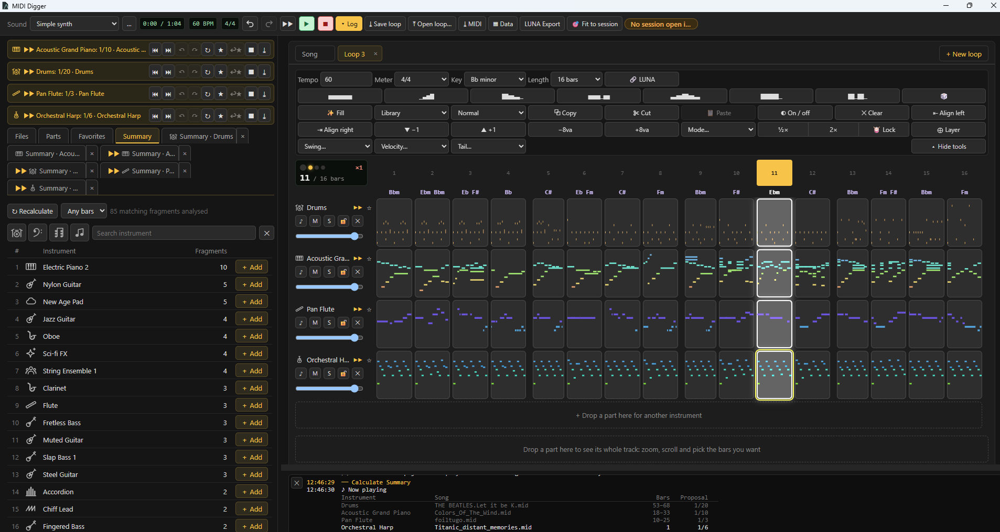
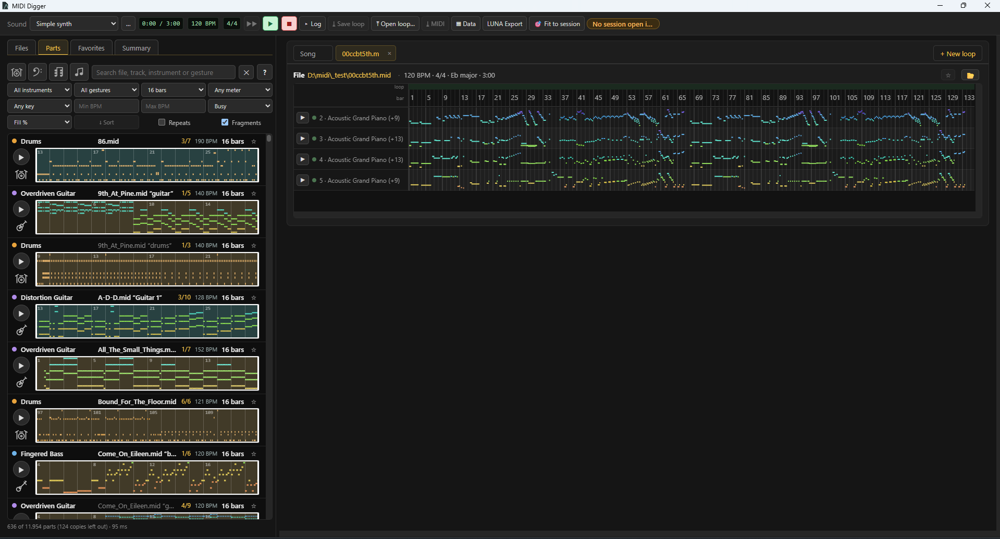

# MIDI Digger

**Turn your own MIDI library into loops, inside LUNA.**

MIDI Digger reads the MIDI files you already have, cuts every instrument into musical
fragments, and finds the ones that fit what you are playing: same harmony, same groove.
Build a loop in minutes, audition alternatives instrument by instrument, and send it to
your LUNA session as MIDI tracks or rendered audio.

## What it does

- **Dig your library.** Point it at a folder of `.mid` files. Every channel of every file
  becomes a part (drums, bass, chords or melody) with its key, tempo and meter, cut into
  loops and phrases you can search and play.
- **Find what fits.** Every fragment is scored against what is playing, note against note and
  hit against hit, and shown green, amber or red.
- **Build loops fast.** Drop parts on the pads, or press **✨ Fill**: it proposes the
  instruments and fragments that fit your loop best. **Arrange** lays out build-ups,
  breakdowns and more.
- **Audition alternatives.** **▶▶** plays each instrument's best proposals one after another,
  in time with the loop; keep the one you like.
- **Fit to your session.** **🎯 Fit to session** reads the MIDI and audio tracks of your LUNA
  session and ranks fragments by how well they go with them.
- **Send to LUNA.** As MIDI on new tracks, or as audio rendered with the built-in General MIDI
  soundfont. Export MIDI files too.

## Free and paid

| | |
|---|---|
| **Free, always** | Browse and analyse your library, search parts, preview, favourites, send parts to LUNA |
| **7-day trial, then a licence** | The loops: New loop, Fill, Arrange, Summary, playlists, Fit to session over a loop |

**[Buy a licence on Gumroad](https://pablotab2.gumroad.com/l/gufosk)**: one licence works on up to 3 of
your computers. Updates of version 1 are included. MIDI Digger ships **no MIDI files**: it
works with your own library.

## Install

1. Download `MIDI-Digger.lunaaddon` from the [latest release](https://github.com/pablortiz/MidiDigger/releases/latest)
   (or get it from LUNA's Discover).
2. Double-click it, then open LUNA → **Add Ons → MIDI Digger**.
3. Choose your MIDI folder and press **Analyse**.

Requires LUNA 3.1.1 or later (tested on Windows). The licence key is checked with Gumroad
once when you enter it; after that MIDI Digger works offline. Nothing about your music or
your files leaves your computer.

## How it works

### 1. Analysing files and extracting fragments

**Per file**
- Split by MIDI channel. Each channel becomes a part with a role: drums (channel 10), bass,
  chords or melody.
- Key: the key signature written in the file; when there is none (or it is the default
  C major), Krumhansl-Kessler correlation over the 24 keys.
- Tempo and meter from the file, any meter: bars follow the file's time-signature changes.

**Fragments**
- Each part is cut at its silences: every group of notes between rests is a candidate fragment.
- Loops are found with a bar-by-bar self-similarity matrix (every bar compared with every
  other). Repeated bars collapse into one loop with a repeat count.
- Duplicates within a part count once. Fragments of 1 to 16 bars are kept.

**Saving the analysis.** *Data → Save analysis* stores every fragment with its role, length,
tempo, key, and the note and hit summaries the fit measures are worked out from. Ticking
*Include MIDI events* also stores each fragment's notes, volume, pan, sustain, pitch bend and
tempo. *Restore* brings a saved analysis back without analysing again.

### 2. How a fragment is scored against the music

Each candidate is compared with what is playing on 9 measures, each multiplied by its weight,
plus a fixed value. The result goes through a logistic function: a 0 to 1 chance that the
fragment was written for that music. Weights for bass, chords and melody; drums use rhythm only.

| Measure | What it measures | Weight | Drums |
|---|---|---:|---:|
| clash | semitone clashes (up or down) when both sound | −3.52 | – |
| chroma | same pitch classes, bar by bar | +4.52 | – |
| harmonyCover | fragment notes on the context's notes | +0.15 | – |
| hit | fragment hits landing with the context's (±1) | +0.08 | +0.72 |
| cover | context hits the fragment also plays | +0.06 | +1.04 |
| beat | same split of the beat (straight / swing / triplets) | +2.88 | +3.69 |
| accent | same places of the bar struck | −1.09 | −1.79 |
| bar | moving together, bar by bar | +2.45 | +1.82 |
| density | how many more hits per bar (in octaves) | +0.23 | +0.14 |
| fixed value | | −4.32 | −3.90 |

The weights were learned by logistic regression from 3,000 songs: real combinations (parts
that were written together) against random ones. On songs it had not seen, it tells them
apart with an AUC of 0.86 for parts with notes and 0.73 for drums.

### 3. How Fill chooses

Each candidate gets five sub-scores from 0 to 1, combined with fixed weights:

**Fill % = 45 % Fit + 25 % Length + 15 % Dynamics + 5 % Activity + 10 % Role**

| Part | Weight | What it measures |
|---|---:|---|
| Fit | 45 % | the 9 measures above: notes and rhythm against what the loop plays |
| Length | 25 % | how much of the target bars the fragment fills |
| Dynamics | 15 % | how close its note velocities are to the loop's |
| Activity | 5 % | how close its note density is to the loop's |
| Role | 10 % | how often this instrument goes with the loop's instruments, learned from your analysed songs |

The best-scoring fragments of each instrument become its playlist (▶▶), so you can hear the
alternatives in turn and keep the one you like.

## Licence

© 2026 elper.es (Pablo Ortiz). All rights reserved. See [LICENSE.txt](LICENSE.txt) and
[THIRD-PARTY-NOTICES.txt](THIRD-PARTY-NOTICES.txt). MIDI Digger is not made, tested or endorsed
by Universal Audio, Inc. MIDI Digger is closed source: this repository holds its documentation
and releases.
