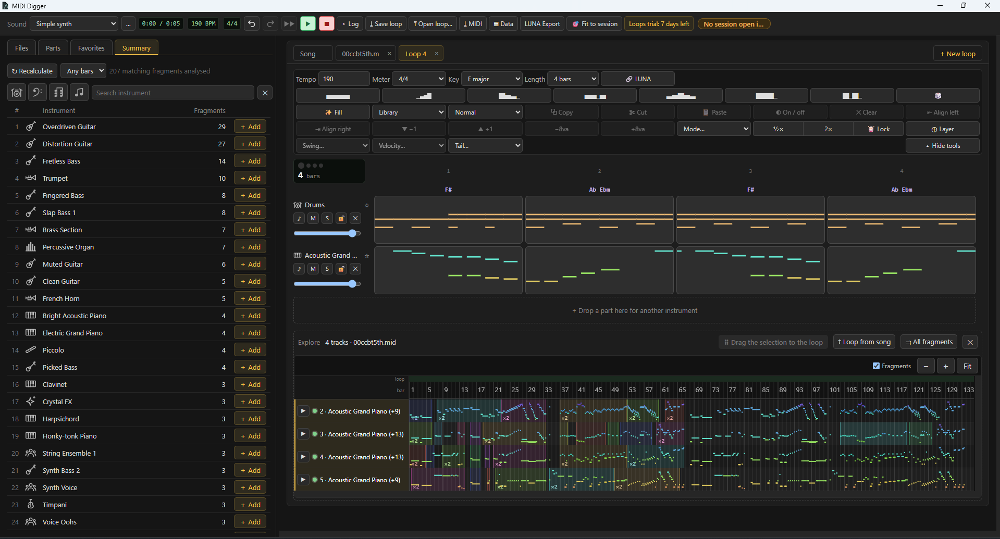

# MIDI Digger

**Turn the MIDI files you already have into loops that fit — in minutes, inside LUNA.**

Free to browse your library, search parts and send them to LUNA. The loop tools come with a
**7-day free trial**, then a one-time licence: **[Buy a licence](https://pablotab2.gumroad.com/l/gufosk?utm_source=readme&utm_medium=github)**.

## Why MIDI Digger

- **✨ Fill finds the part that fits.** Select some pads and press Fill: it searches your
  whole library for the drums, bass, chords or melody that go with what is playing — same
  harmony, same groove — puts the best one in, in your key, and lists the alternatives.
- **⟳ Rotate keeps the loop alive.** While the loop plays, one instrument at a time gets a new
  part that fits the others. Switch it on and off as you play to choose what changes.
- **Your music, not stock samples.** It works with your own MIDI collection: thousands of
  real songs become a palette of parts you can search, hear and combine.

## Also

- **Find what fits.** Every fragment is scored against what is playing and shown green,
  amber or red.
- **Audition alternatives.** **▶▶** plays each instrument's best proposals one after another,
  in time with the loop; keep the one you like.
- **Fill several zones at once.** Ctrl + click pads anywhere in the loop: Fill completes them
  one after another, the base first.
- **Copy between loops.** Copy zones of one loop and paste them into another, in the same bars;
  drag them to move them.
- **Arrange** lays out build-ups, breakdowns and more.
- **Follow a song.** **📍 Locate** shows where a pad comes from; **⇥ Continue** fills the
  rest of the loop with the bars that follow in that song.
- **🎯 Fit to session** ranks your library against the tracks of your LUNA session.
- **Send to LUNA** as MIDI tracks or as rendered audio; export MIDI files too.

## Free and paid

| | |
|---|---|
| **Free, always** | Browse and analyse your library, search parts, preview, favourites, send parts to LUNA |
| **7-day free trial, then a licence** | The loops: New loop, Fill, Rotate, Arrange, Summary, playlists, Locate and Continue, Fit to session over a loop |

**[Buy a licence on Gumroad](https://pablotab2.gumroad.com/l/gufosk?utm_source=readme&utm_medium=github)** — one-time payment, works
on up to 3 of your computers, updates of version 1 included. MIDI Digger ships **no MIDI
files**: it works with your own library.

## Install

1. Install it from LUNA's **Discover**, or download `MIDI-Digger.lunaaddon` from the
   [latest release](https://github.com/pablortiz/MidiDigger/releases/latest) and double-click it.
2. Open LUNA → **Add Ons → MIDI Digger**.
3. Choose your MIDI folder and press **Analyse** (all of it, or a range of its folders).

Requires LUNA 3.1.1 or later (tested on Windows).

**What goes online.** The licence key is checked with Gumroad when you enter it, and again
about once a week when there is a connection; without one, MIDI Digger keeps working. Once a
day it also asks GitHub whether there is a new version and elper.es whether there is an offer.
Nothing about your music, your files or you is sent. Since LUNA 3.1.2, LUNA asks you to allow
these three servers (api.gumroad.com, api.github.com, elper.es) when you install MIDI Digger;
you can change it in **Settings → Add Ons → Servers**. Allow api.gumroad.com to activate a licence.

**Updating.** Since LUNA 3.1.2 an update starts the add-on with a clean slate, but MIDI Digger
keeps your licence, trial and library folder in LUNA's preferences, so you don't need to enter
your key again.

**How does it decide what fits?** The measures, the weights learned from 3,000 songs and how
Fill chooses: [How MIDI Digger works](https://github.com/pablortiz/MidiDigger/blob/main/docs/how-it-works.md).

## Support

Something not working, a problem with your licence key, or a question? Write to
**[pot@elper.es](mailto:pot@elper.es?subject=MIDI%20Digger)**. Say which version you have (it is in
the title bar of MIDI Digger's window) and what you were doing.

## Licence

© 2026 elper.es (Pablo Ortiz). All rights reserved. See
[LICENSE.txt](https://github.com/pablortiz/MidiDigger/blob/main/LICENSE.txt) and
[THIRD-PARTY-NOTICES.txt](https://github.com/pablortiz/MidiDigger/blob/main/THIRD-PARTY-NOTICES.txt).
MIDI Digger is not made, tested or endorsed by Universal Audio, Inc. MIDI Digger is closed
source: this repository holds its documentation and releases.
